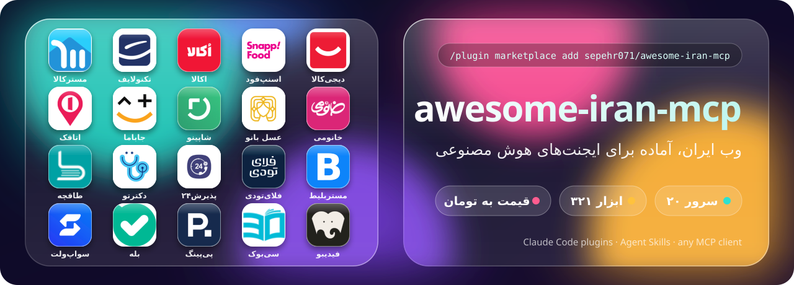

<div align="center">



[English](README.md) · **فارسی**

</div>

<div dir="rtl">

# awesome-iran-mcp

<p align="center">
<b>وب ایران را به ایجنت هوش مصنوعی‌تان بدهید.</b><br>
۱۹ سرور MCP متن‌باز برای دیجی‌کالا، اسنپ‌فود، جاباما، مستربلیط، پذیرش۲۴، طاقچه و بقیه.<br>
جست‌وجو، مقایسهٔ قیمت به تومان، پیدا کردن نوبت خالی و تخفیف‌های امروز، از داخل Claude، Cursor، VS Code یا هر کلاینت MCP.<br>
به‌صورت پلاگین Claude Code همراه با اسکیل نصب کنید، یا به‌صورت Agent Skills برای Codex، Cursor، Antigravity و Grok Build.
</p>

<p align="center">
<a href="#سرورها">سرورها</a> · <a href="#شروع-سریع">شروع سریع</a> · <a href="#برای-ایجنت‌ها">برای ایجنت‌ها</a> · <a href="TOOLS.md">همهٔ ابزارها</a> · <a href="#پرسش‌های-رایج">پرسش‌های رایج</a>
</p>

---

## چرا؟

سایت‌های ایرانی برای ایجنت‌ها ساخته نشده‌اند. بیشترشان API عمومی ندارند، یک صفحه قیمت را ریال نشان می‌دهد و صفحهٔ بعد تومان، و هر سایت بهترین تخفیف‌هایش را پشت یک منوی متفاوت پنهان کرده است. هر سرور این مجموعه API واقعی (و مستندنشدهٔ) یک سایت را نقشه‌برداری و تست کرده و آن را به شکل ابزارهای تمیز MCP با قیمت **تومان** در اختیار ایجنت می‌گذارد.

چند سرور را کنار هم بگذارید تا یک جمله کار یک روز گشتن بین تب‌ها را انجام دهد (مثال نمایشی):

> **شما:** پنجشنبهٔ آینده از تهران به کیش می‌روم، سه شب. ارزان‌ترین پرواز، ویلای زیر شبی ۴ میلیون تومان، و یک متخصص پوست در کیش با نوبت خالی.
>
> **ایجنت:** پرواز از `mrbilit`، اقامتگاه از `jabama` و `otaghak`، پزشک از `paziresh24`
>
> | | انتخاب | قیمت (تومان) |
> |---|---|---:|
> | پرواز | پنجشنبه ۰۷:۴۰، اکونومی، ۲ صندلی باقی‌مانده | ۲٬۱۸۰٬۰۰۰ |
> | اقامت | ویلای دوخوابه نزدیک ساحل، ۴٫۸ ستاره | ۳٬۶۵۰٬۰۰۰ برای هر شب |
> | پزشک | متخصص پوست، شنبه ۱۰:۳۰، حضوری | ۴۵۰٬۰۰۰ |

## شروع سریع

هر سرور یک پکیج کوچک پایتون روی PyPI است که با [`uvx`](https://docs.astral.sh/uv/) اجرا می‌شود. نه کلید API لازم است و نه نصب جداگانه؛ فقط `payping-mcp` و `bale-mcp` روی حساب خودتان کار می‌کنند و توکن می‌خواهند.

**پلاگین‌های Claude Code** (سرور + اسکیل، هر کدام را که خواستید): یک بار مارکت‌پلیس را اضافه کنید، بعد سرورها را در تب Discover دستور `/plugin` انتخاب کنید یا با نام نصب کنید.

</div>

```bash
claude plugin marketplace add sepehr071/awesome-iran-mcp
claude plugin install digikala@iran-mcp            # one server
claude plugin install iran-travel@iran-mcp         # a bundle: food, shopping, beauty, travel, health, books
claude plugin install iran-all@iran-mcp            # every read-only site server
```

<div dir="rtl">

دستور `claude plugin install <name> --marketplace sepehr071/awesome-iran-mcp` هر دو مرحله را با یک دستور انجام می‌دهد. `payping` و `bale` روی حساب خودتان کار می‌کنند، برای همین در هیچ بسته‌ای نیستند؛ آن‌ها را با نام نصب کنید.

**اسکیل برای ایجنت‌های دیگر** (Codex، Cursor، Gemini CLI و ...): اسکیل‌های لازم را انتخاب کنید و بعد هر سرور را با کانفیگ پایین اضافه کنید.

</div>

```bash
npx skills add sepehr071/awesome-iran-mcp
```

<div dir="rtl">

**Grok Build** همین مارکت‌پلیس را می‌خواند: `grok plugin marketplace add sepehr071/awesome-iran-mcp`، بعد سرورها را یکی‌یکی نصب کنید (Grok اعضای بسته‌ها را نصب نمی‌کند). اینکه هر ایجنت چه چیزی را پشتیبانی می‌کند: [PLUGINS.md](PLUGINS.md#compatibility).

**یک سرور** (Claude Code، بدون پلاگین):

</div>

```bash
claude mcp add digikala -- uvx digikala-mcp
```

<div dir="rtl">

**هر کلاینت MCP** (Claude Desktop، Cursor، Windsurf، VS Code و ...):

</div>

```json
{
  "mcpServers": {
    "digikala": { "command": "uvx", "args": ["digikala-mcp"] },
    "jabama":   { "command": "uvx", "args": ["jabama-mcp"] }
  }
}
```

<div dir="rtl">

**هر ۱۹ سرور با هم:** این مخزن را کلون کنید و در Claude Code باز کنید. فایل [`.mcp.json`](.mcp.json) همهٔ سرورها را ثبت می‌کند؛ هر کدام را که لازم دارید تأیید کنید.

</div>

```bash
git clone https://github.com/sepehr071/awesome-iran-mcp
cd awesome-iran-mcp && claude
```

<div dir="rtl">

> [!TIP]
> ۳۰۸ ابزار کانتکست زیادی می‌گیرد. به‌جای همه، فقط سرورهای لازم برای همان کار را فعال کنید.

## سرورها

### 🛒 خرید

| سرور | سایت | ابزار | نسخه | آخرین تغییر | ایجنت چه می‌تواند بکند |
|---|---|---:|:---:|:---:|---|
| [digikala-mcp](https://github.com/sepehr071/digikala-mcp) | [دیجی‌کالا](https://www.digikala.com) (با فرش) | ۲۳ | [](https://pypi.org/project/digikala-mcp/) | [](https://github.com/sepehr071/digikala-mcp/commits/main) | جست‌وجو با فیلتر ویژگی، بهترین انتخاب برای یک بودجه، همهٔ فروشنده‌ها، تاریخچهٔ قیمت، نظرها، تخفیف‌ها |
| [technolife-mcp](https://github.com/sepehr071/technolife-mcp) | [تکنولایف](https://www.technolife.com) | ۱۹ | [](https://pypi.org/project/technolife-mcp/) | [](https://github.com/sepehr071/technolife-mcp/commits/main) | کالای دیجیتال: قیمت نقد و اقساط هر فروشنده، مشخصات، نظرها، تخفیف‌ها |
| [masterkala-mcp](https://github.com/sepehr071/masterkala-mcp) | [مسترکالا](https://masterkala.com) | ۱۴ | [](https://pypi.org/project/masterkala-mcp/) | [](https://github.com/sepehr071/masterkala-mcp/commits/main) | گجت و لوازم جانبی: قیمت، مشخصات، تخفیف‌ها |
| [shopino-mcp](https://github.com/sepehr071/shopino-mcp) | [شاپینو](https://shopino.app) | ۱۴ | [](https://pypi.org/project/shopino-mcp/) | [](https://github.com/sepehr071/shopino-mcp/commits/main) | پوشاک از هزاران فروشگاه: قیمت، سایز، موجودی، امتیاز فروشگاه |

### 💄 آرایشی و بهداشتی

| سرور | سایت | ابزار | نسخه | آخرین تغییر | ایجنت چه می‌تواند بکند |
|---|---|---:|:---:|:---:|---|
| [khanoumi-mcp](https://github.com/sepehr071/khanoumi-mcp) | [خانومی](https://www.khanoumi.com) | ۱۲ | [](https://pypi.org/project/khanoumi-mcp/) | [](https://github.com/sepehr071/khanoumi-mcp/commits/main) | آرایشی، مراقبت پوست و مو، عطر: قیمت، رنگ‌ها، نظرها، تخفیف‌ها |
| [asalbanoo-mcp](https://github.com/sepehr071/asalbanoo-mcp) | [عسل بانو](https://asalbanooshop.com) | ۱۲ | [](https://pypi.org/project/asalbanoo-mcp/) | [](https://github.com/sepehr071/asalbanoo-mcp/commits/main) | آرایشی و مراقبت مو: قیمت، تنوع‌ها، تخفیف‌ها |

### 🍕 غذا و سوپرمارکت

| سرور | سایت | ابزار | نسخه | آخرین تغییر | ایجنت چه می‌تواند بکند |
|---|---|---:|:---:|:---:|---|
| [snapp-mcp](https://github.com/sepehr071/snapp-mcp) | [اسنپ‌فود](https://snappfood.ir) + اسنپ‌مارکت | ۲۱ | [](https://pypi.org/project/snapp-mcp/) | [](https://github.com/sepehr071/snapp-mcp/commits/main) | ارزان‌ترین غذای نزدیک شما، منوها، فودپارتی، سوپرمارکت |
| [okala-mcp](https://github.com/sepehr071/okala-mcp) | [اکالا](https://okala.com) | ۱۶ | [](https://pypi.org/project/okala-mcp/) | [](https://github.com/sepehr071/okala-mcp/commits/main) | فروشگاه‌هایی که به آدرس شما ارسال دارند، مقایسهٔ قیمت بین فروشگاه‌ها، تخفیف‌ها |

### ✈️ سفر و اقامت

| سرور | سایت | ابزار | نسخه | آخرین تغییر | ایجنت چه می‌تواند بکند |
|---|---|---:|:---:|:---:|---|
| [mrbilit-mcp](https://github.com/sepehr071/mrbilit-mcp) | [مستربلیط](https://mrbilit.com) | ۲۲ | [](https://pypi.org/project/mrbilit-mcp/) | [](https://github.com/sepehr071/mrbilit-mcp/commits/main) | ارزان‌ترین پرواز، قطار، اتوبوس، تاکسی و هتل؛ صندلی و قوانین استرداد |
| [flytoday-mcp](https://github.com/sepehr071/flytoday-mcp) | [فلای‌تودی](https://www.flytoday.ir) | ۲۲ | [](https://pypi.org/project/flytoday-mcp/) | [](https://github.com/sepehr071/flytoday-mcp/commits/main) | پرواز، قطار، اتوبوس، هتل، ویلا؛ CIP، سیم‌کارت eSIM، ویزا، تفریحات |
| [jabama-mcp](https://github.com/sepehr071/jabama-mcp) | [جاباما](https://www.jabama.com) | ۲۱ | [](https://pypi.org/project/jabama-mcp/) | [](https://github.com/sepehr071/jabama-mcp/commits/main) | اقامتگاه با قیمت دقیق، تورهای گروهی، رویدادها و بلیط تئاتر |
| [otaghak-mcp](https://github.com/sepehr071/otaghak-mcp) | [اتاقک](https://www.otaghak.com) | ۱۵ | [](https://pypi.org/project/otaghak-mcp/) | [](https://github.com/sepehr071/otaghak-mcp/commits/main) | ویلا و کلبه: موجودی، قیمت دقیق اقامت، نظرها، میزبان‌ها |

### 🩺 سلامت

| سرور | سایت | ابزار | نسخه | آخرین تغییر | ایجنت چه می‌تواند بکند |
|---|---|---:|:---:|:---:|---|
| [paziresh24-mcp](https://github.com/sepehr071/paziresh24-mcp) | [پذیرش۲۴](https://www.paziresh24.com) | ۱۲ | [](https://pypi.org/project/paziresh24-mcp/) | [](https://github.com/sepehr071/paziresh24-mcp/commits/main) | پزشکان، هزینهٔ ویزیت، نظرها، نوبت‌های خالی |
| [doctoreto-mcp](https://github.com/sepehr071/doctoreto-mcp) | [دکترتو](https://doctoreto.com) | ۱۴ | [](https://pypi.org/project/doctoreto-mcp/) | [](https://github.com/sepehr071/doctoreto-mcp/commits/main) | پزشکان، هزینهٔ ویزیت، نوبت خالی، نظرها، کلینیک‌ها، آزمایشگاه‌ها، تخفیف‌ها |

### 📚 کتاب

| سرور | سایت | ابزار | نسخه | آخرین تغییر | ایجنت چه می‌تواند بکند |
|---|---|---:|:---:|:---:|---|
| [taaghche-mcp](https://github.com/sepehr071/taaghche-mcp) | [طاقچه](https://taaghche.com) | ۱۲ | [](https://pypi.org/project/taaghche-mcp/) | [](https://github.com/sepehr071/taaghche-mcp/commits/main) | کتاب الکترونیکی و صوتی: قیمت، تخفیف، نظرها، پرفروش‌ها، کتاب رایگان |
| [fidibo-mcp](https://github.com/sepehr071/fidibo-mcp) | [فیدیبو](https://fidibo.com) | ۱۱ | [](https://pypi.org/project/fidibo-mcp/) | [](https://github.com/sepehr071/fidibo-mcp/commits/main) | کتاب الکترونیکی و صوتی: قیمت، فیدیبو پلاس، نظرها، پرفروش‌ها، کتاب رایگان |
| [30book-mcp](https://github.com/sepehr071/30book-mcp) | [سی‌بوک](https://www.30book.com) | ۱۴ | [](https://pypi.org/project/30book-mcp/) | [](https://github.com/sepehr071/30book-mcp/commits/main) | کتاب چاپی: قیمت پشت جلد و با تخفیف، موجودی، چاپ‌ها، شابک، تخفیف‌ها |

### 💳 حساب‌های خودتان (توکن لازم است)

| سرور | سایت | ابزار | نسخه | آخرین تغییر | ایجنت چه می‌تواند بکند |
|---|---|---:|:---:|:---:|---|
| [payping-mcp](https://github.com/sepehr071/payping-mcp) | [پی‌پینگ](https://www.payping.ir) | ۲۱ | [](https://pypi.org/project/payping-mcp/) | [](https://github.com/sepehr071/payping-mcp/commits/main) | خواندن موجودی، فروش و مشتری‌ها؛ ساخت محصول، لینک پرداخت، کوپن و فاکتور |
| [bale-mcp](https://github.com/sepehr071/bale-mcp) | پیام‌رسان [بله](https://bale.ai) | ۱۳ | [](https://pypi.org/project/bale-mcp/) | [](https://github.com/sepehr071/bale-mcp/commits/main) | خواندن و پاسخ دادن به پیام‌های ربات شما، پرسیدن و منتظر جواب ماندن، ارسال فایل |

فهرست همهٔ ابزارها با یک خط توضیح: [TOOLS.md](TOOLS.md)

## برای ایجنت‌ها

این مخزن طوری ساخته شده که ایجنت‌ها هم به راحتی آدم‌ها بخوانندش:

| فایل | چیست |
|---|---|
| [`AGENTS.md`](AGENTS.md) | کدام سرور برای کدام کار، قراردادها، قوانین ایمنی، نحوهٔ کار در این مخزن |
| [`servers.json`](servers.json) | کاتالوگ ماشین‌خوان: پکیج، نسخه، دسته، متغیرهای محیطی و همهٔ ابزارهای هر سرور |
| [`TOOLS.md`](TOOLS.md) | هر ۳۰۸ ابزار به تفکیک سرور |
| [`llms.txt`](llms.txt) | فهرست کوتاه برای LLMها |
| [`.mcp.json`](.mcp.json) | تنظیمات آماده برای همهٔ سرورها |
| [`.claude-plugin/marketplace.json`](.claude-plugin/marketplace.json) | مارکت‌پلیس پلاگین `iran-mcp`: یک پلاگین برای هر سرور به‌اضافهٔ بسته‌ها |
| [`plugins/`](plugins) | هر پلاگین: سرور MCP آن، پین‌شده روی یک نسخهٔ منتشرشده، و یک `SKILL.md` که می‌گوید کی و با چه قوانینی استفاده شود |
| [`PLUGINS.md`](PLUGINS.md) | سازگاری با ایجنت‌ها، و اینکه نسخهٔ جدید یک سرور چطور به کاربران پلاگین می‌رسد |

این را به ایجنت‌تان بدهید تا خودش راه‌اندازی کند:

</div>

```text
Read https://raw.githubusercontent.com/sepehr071/awesome-iran-mcp/main/AGENTS.md, then add the MCP servers I need for <task> to my MCP config.
```

<div dir="rtl">

## قراردادهای مشترک

- **قیمت‌ها همیشه تومان است**، حتی وقتی API سایت ریال برمی‌گرداند.
- **فقط خواندنی.** سرورهای خرید، سفر، سلامت و کتاب هرگز وارد حساب نمی‌شوند، سبد خرید پر نمی‌کنند، رزرو یا پرداخت نمی‌کنند. `payping-mcp` و `bale-mcp` می‌توانند بنویسند، ولی فقط روی حساب خودتان، با توکن خودتان، روی سیستم خودتان.
- **تصویر:** نتایج محصول، اقامتگاه، هتل و پزشک در صورت وجود یک لینک `image` دارند.
- **پروکسی:** هر سرور یک متغیر اختیاری `<NAME>_MCP_PROXY` می‌خواند (مثلاً `DIGIKALA_MCP_PROXY`) برای سایت‌هایی که IP شما را مسدود می‌کنند. تنظیمات پروکسی سیستم نادیده گرفته می‌شود. نام دقیق‌ها در [`servers.json`](servers.json) است.

## کار با سورس

هر سرور مخزن خودش را دارد و اینجا به‌صورت git submodule در پوشهٔ `servers/` قرار گرفته است.

</div>

```bash
git clone --recurse-submodules https://github.com/sepehr071/awesome-iran-mcp
cd awesome-iran-mcp/servers/digikala-mcp
uv sync && uv run pytest -q          # offline tests
uv run pytest -m live -q             # against the real site

# update every server to latest main and rebuild the catalog
git submodule update --init --remote
python scripts/catalog.py            # also rewrites plugins/ and .claude-plugin/
python scripts/banner.py
claude plugin validate .
```

<div dir="rtl">

یک GitHub Action هر شب همهٔ این کارها را انجام می‌دهد و نتیجه را commit می‌کند. روند کامل انتشار در [PLUGINS.md](PLUGINS.md) آمده است.

باگ‌ها و درخواست‌های هر سرور را در مخزن همان سرور ثبت کنید.

## پرسش‌های رایج

<details>
<summary><b>این سرورها رسمی هستند؟</b></summary>

نه. غیررسمی‌اند و به هیچ‌کدام از سایت‌ها وابسته نیستند. همان endpointهایی را صدا می‌زنند که اپ وب خود سایت استفاده می‌کند. این APIها مستند نیستند و ممکن است تغییر کنند؛ اگر چیزی خراب شد در مخزن همان سرور issue باز کنید.
</details>

<details>
<summary><b>از خارج ایران سایت timeout یا خطای 403 می‌دهد.</b></summary>

بعضی سایت‌ها IP خارجی را مسدود می‌کنند. متغیر پروکسی همان سرور را روی یک پروکسی با خروجی ایران بگذارید، مثلاً <code>DIGIKALA_MCP_PROXY=http://127.0.0.1:8080</code>.
</details>

<details>
<summary><b>ایجنت می‌تواند برایم سفارش بدهد یا پرداخت کند؟</b></summary>

نه. سرورهای سایت‌ها عمداً فقط خواندنی‌اند. ایجنت پیدا و مقایسه می‌کند؛ خرید با شماست.
</details>

<details>
<summary><b>پایتون لازم دارم؟</b></summary>

فقط <a href="https://docs.astral.sh/uv/getting-started/installation/">uv</a> لازم است. <code>uvx</code> در اولین اجرا پایتون مناسب و پکیج را دانلود می‌کند.
</details>

<details>
<summary><b>به‌روزرسانی‌ها را چطور بگیرم؟</b></summary>

پلاگین‌ها هر سرور را روی یک نسخهٔ منتشرشده پین می‌کنند، پس به‌روزرسانی پلاگین یعنی به‌روزرسانی سرور. یک بار در <code>/plugin</code> ← <b>Marketplaces</b> ← <code>iran-mcp</code> به‌روزرسانی خودکار را روشن کنید، یا <code>claude plugin update &lt;name&gt;@iran-mcp</code> را اجرا کنید. تنظیم سادهٔ <code>uvx digikala-mcp</code> همان نسخهٔ کش‌شده را اجرا می‌کند؛ برای ارتقا یک بار <code>uvx digikala-mcp@latest --help</code> را اجرا کنید و کلاینت را دوباره باز کنید.
</details>

## مجوز

[MIT](LICENSE). هر سرور در مخزن خودش با مجوز MIT منتشر شده است. نام‌ها، لوگوها و نشان‌های تجاری سایت‌ها متعلق به صاحبانشان است و فقط برای معرفی هر سایت آمده‌اند.

</div>
